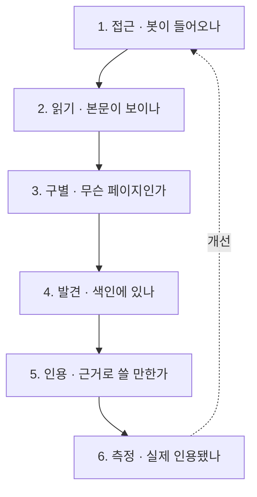
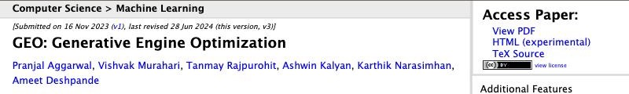
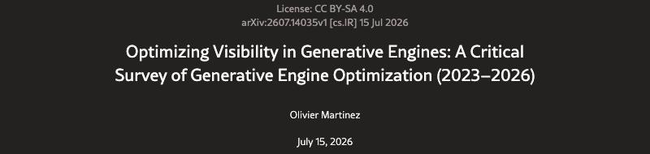
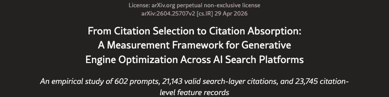
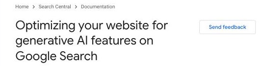

<div align="center">

# 🔎 geo-study

**AI 검색 시대에 개발자는 무엇을 필수로 만들고, 무엇을 만들지 않아도 될까?**

GEO 자료를 읽고, 개발자가 챙길 항목을 예제 사이트와 점검 도구로 직접 만들어 보며 정리한 공부 기록입니다.


</div>

---

## 📌 한눈에 보기

- **GEO란**: ChatGPT · Claude 같은 AI 답변에 인용되도록 사이트를 최적화하는 일
- **고민**: 쏟아지는 GEO 조언 중 개발자가 꼭 해야 할 일은 무엇일까?
- **방법**: 연구 자료 확인 → 예제 구현 → 점검 도구 작성 → 실제 사이트 현재 상태 점검
- **제 결론**: 새 기술 추가보다 AI가 읽고 찾을 수 있는 기반이 먼저라고 봤습니다
- **주의**: 실제 사이트 적용과 효과 측정은 아직 하지 않았습니다
- **다음**: 여기서 조사한 내용을 Tripfx에 적용해 측정을 시도해 보려고 합니다

---

## 🌱 출발점

- 요즘 GEO가 화두인데 조언은 많고, 근거는 제각각이었습니다.
- 개발자로서 어디까지 대응해야 하는지 판단하기 어려웠습니다.
- 그래서 세 가지를 직접 확인해 보려고 했습니다.
  - 지금 만든 사이트가 실제로 Claude 검색에 나올까?
  - 많이 추천되는 작업은 근거가 있을까?
  - 필수 작업과 없어도 되는 작업을 어떻게 나눌까?

---

## 🧭 고민의 과정

### 1. "최대 40% 향상"을 그대로 믿지 않았습니다

- **고민**: 가장 많이 인용되는 이 수치가 실제 서비스에도 통할까?
- **확인**: 크롤링과 검색을 뺀 환경의 한 지표에서 나온 최대치였습니다.
- **판단**: 실제 서비스에서의 효과는 직접 확인이 필요하다고 봤습니다.

### 2. 글을 읽는 데서 멈추지 않고 직접 검색해 봤습니다

- **고민**: 논문보다 "실제로 Claude로 검색이 되는가"가 궁금했습니다.
- **시도**: 제 공개 저장소를 이름으로, 또 주제로 찾아봤습니다.
- **결과**: 이름 검색은 찾았지만, 주제 검색에는 나오지 않았습니다.
- **판단**: 이름을 모르는 사람에게 발견되는 것이 진짜 과제라고 봤습니다.

### 3. 가상 실험과 실제 적용을 나눴습니다

- **고민**: 처음에는 벤치마크를 만들어 효과를 재려고 했습니다.
- **문제**: 로컬 사이트는 공개 색인에 들어가지 않아 인용을 잴 수 없습니다.
- **결정**: 여기서는 원리와 도구를 익히고, 적용은 운영 사이트에 하려고 합니다.

### 4. 넣는 것만큼 넣지 않을 것을 정하려고 했습니다

- **고민**: `llms.txt`는 많이 추천되는데 정말 필요할까?
- **확인**: 효과를 통제해 검증한 실험을 찾지 못했습니다.
- **결정**: 이번에는 만들지 않고, 필수 항목만 통과하는지 확인했습니다.

---

## 🔄 제가 이해한 흐름

앞 단계가 막히면 뒤 단계를 개선해도 효과를 내기 어렵다고 봤습니다.



---

## ✅ 무엇을 만들고, 무엇을 만들지 않을까

**필수**는 인용 효과가 입증됐다는 뜻이 아닙니다.
없으면 앞 단계가 막히거나 기본 검색 품질이 떨어진다고 판단한 항목입니다.

### 필수라고 본 것

- **첫 HTML에 본문**: JS를 실행하지 않는 봇에 대응하기 위해
- **검색 · 조회 봇 허용**: 막히면 답변 근거로 쓰일 수 없어서
- **CDN · 방화벽 차단 확인**: `robots.txt`와 별개로 막힐 수 있어서
- **페이지별 제목 · 설명**: 페이지를 구별하기 위해
- **주제어가 있는 H1**: 숫자만 있으면 맥락이 없어서
- **대표 주소(canonical)**: 중복 주소를 정리하기 위해
- **사이트맵**: 페이지를 발견하게 하기 위해
- **검색 도구 등록**: 색인 상태를 확인하기 위해
- **봇 · 유입 로그**: 효과를 측정하기 위해

### 권장이라고 본 것

- **실제 변경일**: 최신성 신호가 되어서
- **화면에 보이는 기준일 · 출처**: 사실을 확인할 수 있어서
- **차트 값을 표로도 제공**: 차트는 기계가 읽기 어려워서
- **판단 기준 · 소개 페이지**: 신뢰 근거가 되어서
- **구조화 데이터(JSON-LD)**: 리치 결과에 쓰이지만 인용 효과는 불분명

### 없어도 된다고 본 것

- **`llms.txt`**: 효과 근거가 부족해서
- **AI 전용 파일 · 마크다운**: 구글 검색에는 필요 없다고 안내해서
- **콘텐츠 잘게 쪼개기**: 구글이 필요 없다고 안내해서
- **FAQ 구조화 데이터 남용**: 화면과 어긋날 위험이 있어서

### 하지 않으려는 것

- **봇에게만 다른 내용 제공**: 위장 페이지로 처리될 위험이 있어서
- **숨긴 텍스트 · AI 지시문**: 스팸으로 처리될 위험이 있어서
- **근거 없는 수치 추가**: 신뢰를 해칠 수 있어서

### 개발만으로 정할 수 없는 것

- 학습용 수집 허용 여부는 사업 · 법무 판단이라고 봤습니다.
- 학습 봇과 검색 봇은 따로 제어할 수 있습니다.
- 예제에는 학습을 막고 검색을 허용하는 구성을 넣었습니다.

---

## 🧪 직접 만들어 본 것

필수 항목이 코드에서 어떻게 드러나는지 보려고 가상 환율 데이터로 예제 두 개를 만들었습니다.

- 점검 도구가 문제를 잡아내는지 확인하려는 예제입니다.
- 실제 AI 검색에서 효과를 비교한 것은 아닙니다.

- **렌더링**: 브라우저에서 생성 → 서버에서 생성
- **봇 요청**: 403 차단 → 200 응답
- **제목**: 모두 `Home` → 페이지별 제목
- **사이트맵**: 없음 → 있음
- **`llms.txt`**: 양쪽 모두 없음

`curl`로 받은 엔화 페이지는 이렇게 달랐습니다.

```html
<!-- 개선 전: 브라우저에서는 멀쩡해 보이지만 본문이 없습니다 -->
<title>Home</title></head><body><div id="root"></div>

<!-- 개선 후: 첫 응답에 사실과 판단 근거가 들어 있습니다 -->
<title>엔화 JPY 환율 오늘 · 90일 평균 비교 · 환율 달력</title>
<meta name="description" content="2026-11-04 기준 엔화(JPY) 환율은 100JPY당 850원입니다.
최근 90일 평균 880원보다 3.4% 낮아 싼 편으로 판단합니다.">
```

---

## 🌐 실제 사이트에서 확인한 것

제가 운영 중인 환율 · 여행 물가 사이트 [Tripfx](https://tripfx.pages.dev/)를 읽기 전용으로 점검했습니다. 아직 수정하지는 않았습니다.

### 기술 점검: 필수 항목 8/11 통과

- **통과**: 봇 접근, 첫 HTML 본문, 사이트맵
- **미통과**: 설명 없는 홈 제목, 숫자뿐인 H1, 일부 대표 주소 누락

### Claude 검색 측정: 5개 질문 모두 미노출

- 사이트 이름을 물었을 때: 노출 없음
- 엔화 환전 시점을 물었을 때: 노출 없음
- 나라별 여행 물가를 물었을 때: 노출 없음
- 직구 관세 계산을 물었을 때: 노출 없음
- 여행지 비교 대시보드를 물었을 때: 노출 없음

제가 본 내용은 이렇습니다.

- 페이지는 읽을 수 있는데 검색에서 발견되지 않는 상태로 봤습니다.
- 그래서 콘텐츠 수정보다 검색 도구 등록을 먼저 하려고 합니다.
- 질문별 1회 측정이라 경향만 확인한 결과입니다.

---

## 📚 자료에서 배운 것

- **GEO 원논문**: 크롤링과 검색을 뺀 환경의 실험으로 읽었습니다.
- **2026 서베이**: 인과 근거는 아직 약하다고 봤습니다.
- **플랫폼 비교 연구**: 플랫폼마다 인용 방식이 달랐습니다.
- **Ahrefs 실험**: 구조화 데이터를 대조군과 비교한 사례로 참고했습니다.
- 플랫폼 비교에서 평균 인용은 ChatGPT 6.88개, Perplexity 16.35개였습니다.
- Ahrefs는 페이지 1,885개를 대조군 4,000개와 비교했습니다.
- 다만 이미 많이 인용되던 페이지만 본 실험이라 신규 사이트와는 다릅니다.

---

## 📁 구성

- `sites/before.mjs`: 크롤러에게 안 보이는 예제 사이트
- `sites/after.mjs`: 같은 데이터의 개선 예제
- `tools/geo-check.mjs`: 크롤러 관점 점검
- `tools/bot-log.mjs`: 봇 · AI 유입 집계
- `tools/citation-probe.mjs`: Claude 인용 측정
- `test/geo.test.mjs`: 판정 로직 테스트

---

## 🗺️ 다음 계획: Tripfx에 적용하고 측정하기

- 이 저장소에서는 조사와 예제 작성까지 진행했습니다.
- 다음에는 여기서 조사한 내용을 운영 중인 Tripfx에 적용해 보려고 합니다.
- 적용 전후를 측정해 실제 효과가 있는지 확인을 시도하려고 합니다.
- 효과가 없더라도 그 결과와 원인을 함께 기록하려고 합니다.
- 할 일은 [Tripfx 저장소 이슈](https://github.com/kyungchan3007/harness-auto-web/issues/117)에 정리했습니다.

진행 순서는 이렇게 생각하고 있습니다.

- [ ] Tripfx를 Google · Bing 검색 도구에 등록
- [ ] 사이트 이름 질문의 노출 확인
- [ ] 제목 · H1 · 대표 주소 수정
- [ ] 통화 페이지 절반에만 콘텐츠를 보강해 비교
- [ ] 질문 20~30개를 반복 측정

---

## 📖 근거 자료

나중에 다시 확인하기 쉽도록 자료별로 첫 화면과 근거 위치를 남겼습니다.

### GEO 원논문 (KDD 2024)



- **링크**: [arXiv 2311.09735](https://arxiv.org/abs/2311.09735)
- **근거 위치**: 초록, 학회 채택 표기
- **확인 내용**: "최대 40%"라는 수치와 KDD 2024 채택

### GEO 비판적 서베이 (2026)



- **링크**: [arXiv 2607.14035](https://arxiv.org/html/2607.14035v1)
- **근거 위치**: 4.1절, 6.3절
- **확인 내용**: 원논문의 실험 조건, 검색 미발동 응답을 다루는 방법

### 인용 선택과 답변 반영 측정 연구 (2026)



- **링크**: [arXiv 2604.25707](https://arxiv.org/html/2604.25707v2)
- **근거 위치**: 6장 "Results: Search Triggering and Citation Breadth"
- **확인 내용**: 프롬프트 602개, 평균 인용 6.88개 · 16.35개

### Ahrefs 구조화 데이터 실험 (2026)


- **링크**: [Ahrefs Blog](https://ahrefs.com/blog/schema-ai-citations/)
- **근거 위치**: 제목, "Adding schema didn't boost citations" 부분
- **확인 내용**: 페이지 1,885개와 대조군 4,000개

### Google 생성형 AI 최적화 가이드



- **링크**: [Google Search Central](https://developers.google.com/search/docs/fundamentals/ai-optimization-guide)
- **근거 위치**: "Mythbusting generative AI search" 부분
- **확인 내용**: `llms.txt`, 콘텐츠 쪼개기를 다루는 위치
- **문서 표기**: 최종 수정 2026-07-10

### 그 밖의 자료

- [Google: AI features and your website](https://developers.google.com/search/docs/appearance/ai-features): AI 기능의 별도 요구사항 안내
- [Pixis: llms.txt 근거 정리](https://pixis.ai/blog/does-llms-txt-help-ai-citations-what-the-evidence-actually-shows/): "Does llms.txt increase AI citations?" 부분
- Pixis 페이지는 자동 캡처에서 화면이 비어 이미지를 넣지 못했습니다.
